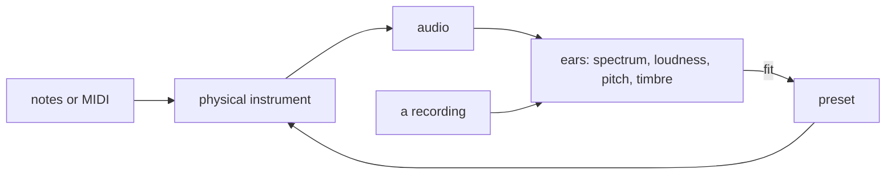

# Soundbench

A studio of instruments that a human or a language model can play.
Each instrument is a physical model in code (strings, bores, membranes, vocal tracts), so it synthesizes its own sound without samples or generative audio models.
Play it from Python notes, a MIDI file or the command line.
The same library carries the ears an agent uses in place of listening: spectrograms, loudness, pitch and timbre measurements, and tools that fit an instrument's parameters to recordings.

[The instrument table](docs/instruments.md) lists each instrument, its settings and its known flaws.



## Make sound

Requires [uv](https://docs.astral.sh/uv/) and [FFmpeg](https://ffmpeg.org/) (`brew install uv ffmpeg`).

```sh
git clone https://github.com/cailmdaley/soundbench.git
cd soundbench
uv sync
uv run soundbench play banjo --pitch 60 --out build/banjo.wav
```

The command renders three plucks at different velocities, including their decay.
Open `build/banjo.wav` in an audio player.
To play a MIDI file instead, use `uv run soundbench play piano --midi notes.mid --out build/piano.wav`.
All note-bearing tracks play the selected instrument; MIDI controllers and pitch bends carry its articulations.

```python
from soundbench import Note, render
import soundfile as sf

notes = [Note(60, start=0, duration=0.5, velocity=72),
         Note(67, start=0.75, duration=0.5, velocity=80)]
audio, sample_rate = render("guitar", notes)
sf.write("guitar.wav", audio, sample_rate, subtype="FLOAT")
```

Audio is a floating-point `[frames, channels]` array at 48 kHz, with no automatic normalization.
A renderer subprocess releases its compilation and audio buffers when each call finishes.
The CLI writes a floating-point WAV so synthesis peaks aren't silently clipped to integers.

## Instruments and tools

The library includes banjo, guitar, piano, upright/electric bass, fiddle, mandolin, dobro, acoustic and electronic drums, keyboards, winds, friction/percussion models, invented instruments, several tract singers, a machine voice, and a room/microphone/tape stage.
Each row of [the instrument table](docs/instruments.md) gives a probe command; the playing sheets under `references/` document each instrument's range, controls and gestures.

```sh
uv run soundbench spectrum build/banjo.wav --out build/banjo.png
uv run soundbench listen --help
uv run soundbench compare --help
uv run soundbench tempo --help
```

An instrument is its physical model; a parameter file is a preset, one setting of that model, set by hand or fitted to some recordings.
The library ships a default for each instrument, and the fitting tools let you reach your own from recordings you choose: install the fitting extra with `uv sync --extra fit` and see [the fitting guide](docs/fitting.md).
Reference audio is an explicit local input, never bundled or downloaded by a render.

[AGENTS.md](AGENTS.md) covers playing, developing and measuring instruments.

## Tests

```sh
uv sync --all-extras
uv run python scripts/test.py
```

Tests render diagnostic notes and can take several minutes.
The runner isolates test files so JIT caches don't accumulate across instruments.
Private-studio delivery checks don't belong to this library; any retained check needing a private recording skips with its reason.

## Licence and credits

MIT, copyright Cail Daley; see [LICENSE](LICENSE).
Soundbench was written by Claude with Cail Daley.

The library ships code and numerical parameters, and no recorded audio.
A fitted parameter file is a preset: one setting of a physical model, reached from some recordings.
Some defaults were set against reference recordings that are not distributed or listed.
The openly licensed sources that parameters draw on, with links, are in [`PROVENANCE.toml`](soundbench/instruments/models/PROVENANCE.toml):

- Salamander Grand Piano V3, Alexander Holm, CC BY 3.0.
- Freesound and Wikimedia Commons recordings by harri (guitar), MrAuralization (tonewheel organ), tim.kahn (Rhodes Mark II) and SGaola (Galician bagpipes), CC BY 4.0.
- MuldjordKit 3, Lars Muldjord / DrumGizmo.org, CC BY 4.0.
- VocalSet, Wilkins, Seetharaman, Wahl and Pardo, CC BY 4.0.
- Asurnipal, *Friction drum in action*, CC BY-SA 4.0 (`ximbomba-austria.toml` is fitted to it and is also offered under CC BY-SA 4.0), and Poniol60, *Zambomba*, CC BY-SA 3.0.
- Philharmonia Orchestra sound samples and the University of Iowa MIS, under their own terms.
- Vocal-tract areas from Story (2008), JASA 123(1):327–335.

CHIMERA (`vendor/chimera`), by Jameson Hodge and contributors, is MIT and keeps its own `LICENSE`; the `chimera-studio` binary and studio expression are this library's additions to the fork.
